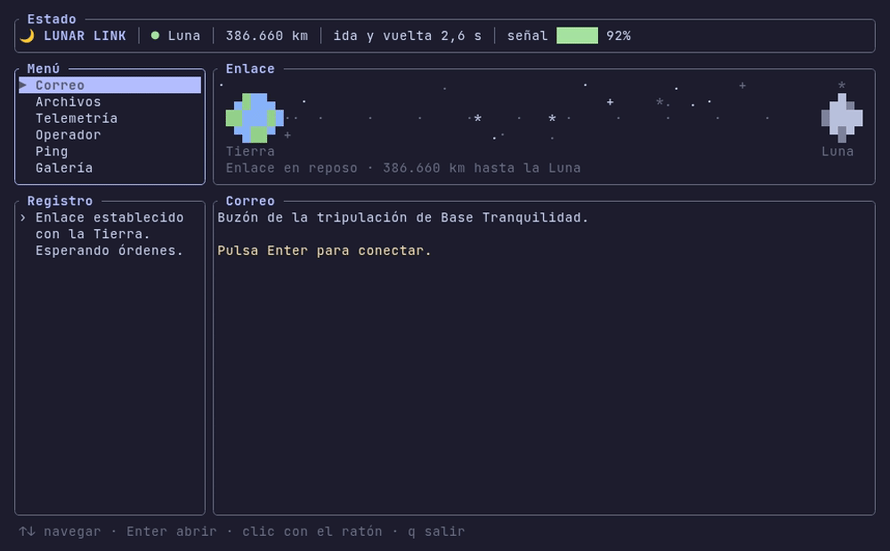
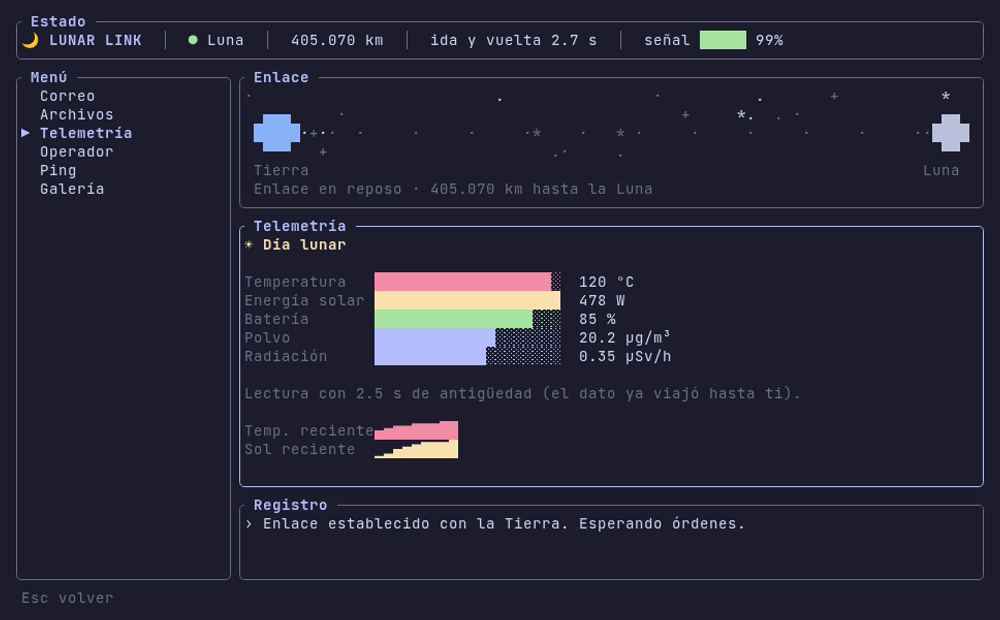
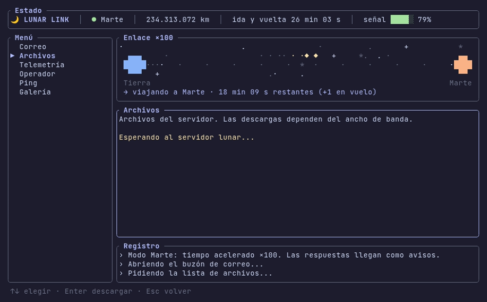
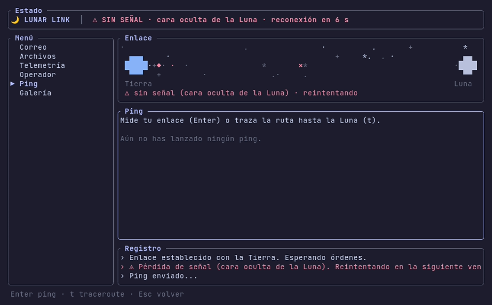
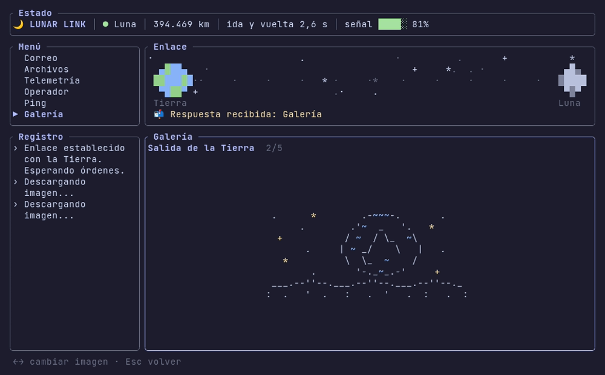

<div align="center">

# 🌙 Lunar Link

[](https://crates.io/crates/lunar-link)


**Simulador de un servidor en la Luna, accesible desde la terminal con el retardo real de la señal.**

</div>

<p align="center"></p>

Lunar Link es una interfaz de terminal (TUI) conectada a una estación lunar simulada. Cada petición sufre el retardo que tendría una señal de radio real: unos **1,3 s por trayecto** hasta la Luna y **entre 3 y 22 minutos** hasta Marte. El enlace modela además la distancia variable, los cortes de señal y un ancho de banda limitado.

Todo el contenido es local y está escrito a mano: no usa red, claves ni modelos de IA.

## Motivación

Con el debate sobre el consumo energético y de agua de los centros de datos, cada vez se habla más de llevarlos al espacio. Lunar Link no pretende resolver esa cuestión: permite **experimentar** cómo sería usar un servicio alojado a 384.000 km y qué implica que la latencia mínima venga impuesta por la velocidad de la luz.

## Funcionalidades

El servidor simula **Base Tranquilidad**, una estación en el Mar de la Tranquilidad:

| Sección | Qué hace |
|---|---|
| **Correo** | Buzón con mensajes de la tripulación; el texto llega con efecto de escritura. |
| **Archivos** | Descargas con barra de progreso limitada por el ancho de banda del enlace (24 KB/s). |
| **Telemetría** | Temperatura, energía solar, batería, polvo y radiación con ciclo día/noche, más gráficas de evolución. Cada dato indica su antigüedad. |
| **Operador** | Diálogo guionizado: se navega por opciones o escribiendo palabras clave. |
| **Ping / traceroute** | Mide la latencia real del enlace y muestra los saltos hasta la base. |
| **Galería** | Ilustraciones ASCII enviadas desde la estación. |

Sobre el enlace:

- **Retardo variable.** La distancia Tierra-Luna oscila entre ~363.000 y ~405.000 km, y el retardo cambia con ella.
- **Cortes de señal.** Hay pérdidas aleatorias, tormentas solares y el paso del relé por la cara oculta. Las peticiones esperan y se reintentan solas.
- **Peticiones concurrentes.** Puedes lanzar varias peticiones y seguir navegando; cada respuesta llega como un aviso.
- **Modo Marte.** Aplica retardos de minutos con el mismo servidor. Con `--speed` se acelera el tiempo de viaje para poder probarlo.
- **Interfaz animada.** Muestra campo de estrellas, paquetes viajando entre la Tierra y su destino, transiciones y gráficas en vivo. Funciona con teclado y ratón, y se adapta a terminales de 256 colores.

## Capturas

| Modo Luna | Modo Marte (×100) |
|---|---|
|  |  |
| **Corte de señal** | **Galería ASCII** |
|  |  |

## Instalación

Requiere Rust 1.88 o superior.

```
cargo install lunar-link
lunar-link
```

Con [cargo-binstall](https://github.com/cargo-bins/cargo-binstall) se descarga el binario precompilado en lugar de compilarlo:

```
cargo binstall lunar-link
```

En la sección de [releases](https://github.com/AdriaBC06/Lunar-Link/releases) también hay binarios precompilados para Linux, macOS y Windows.

Para compilar desde el código fuente:

```
git clone https://github.com/AdriaBC06/Lunar-Link
cd Lunar-Link
cargo run --release
```

## Uso

```
lunar-link                              # enlace Tierra-Luna (por defecto)
lunar-link --target marte               # enlace Tierra-Marte (3-22 min por trayecto)
lunar-link --target marte --speed 100   # Marte con el tiempo de viaje acelerado ×100 (1-10000)
lunar-link --delay 5                    # retardo de ida fijo, en segundos (0-3600)
lunar-link --no-outages                 # sin cortes de señal
```

### Controles

| Tecla | Acción |
|---|---|
| `↑` `↓` / `j` `k` | Moverse por el menú o una lista; desplazar un correo abierto |
| `Enter` / `→` | Abrir una sección o ejecutar la acción |
| `Esc` / `←` | Volver |
| `t` | Traceroute (en Ping) |
| `←` `→` | Cambiar de imagen (en Galería) |
| Clic | Abrir una opción del menú |
| `q` / `Ctrl+C` | Salir |

La terminal debe medir al menos 64×24. Si no admite color verdadero, la interfaz usa la paleta de 256 colores.

## Arquitectura

Es un único binario en Rust. El cliente (la TUI) y el servidor simulado conviven en el mismo proceso, separados por un modelo del enlace:

| Módulo | Responsabilidad |
|---|---|
| `link` | Distancia y retardo, cortes deterministas por semilla, ancho de banda y aceleración del tiempo. |
| `server` | Traduce cada petición en una respuesta con contenido fijo; no conoce el retardo. |
| `content` | Contenido premontado, embebido en el binario desde `src/content.toml`. |
| `app` | Estado de cada sección, peticiones en vuelo y manejo de la entrada. |
| `ui` | Dibujado con `ratatui`: panel del enlace, listas, gráficas y animaciones. |
| `fmt` | Formato de números y duraciones en español. |

Algunas decisiones de diseño:

- Cada petición es una tarea de `tokio` independiente, emparejada con su respuesta por un `id`.
- Los cortes son una función pura del tiempo y de una semilla. La interfaz, los reintentos y los tests consultan así la misma fuente de verdad sin compartir estado.
- Los tests del enlace usan el reloj pausado de `tokio`, de modo que un viaje de 25 minutos a Marte se verifica en microsegundos.

Hay diagramas y más detalle en [`docs/ARCHITECTURE.md`](docs/ARCHITECTURE.md).

**Stack:** Rust · ratatui + crossterm · tokio · clap · serde + TOML.

## Desarrollo

```
cargo test                                # tests unitarios y de renderizado
cargo clippy --all-targets -- -D warnings
cargo fmt --check
```

La CI de GitHub Actions ejecuta estas tres comprobaciones en cada push. El GIF y las capturas se generan con [vhs](https://github.com/charmbracelet/vhs) a partir de los ficheros `.tape` de `docs/`.

## Licencia

[GPL-3.0](LICENSE)
