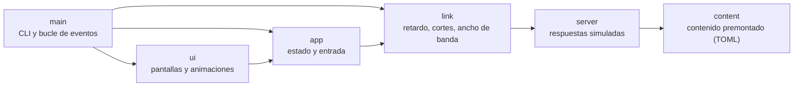
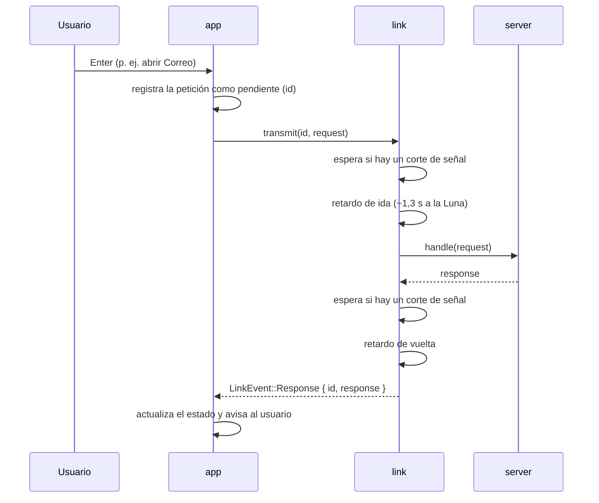

# Arquitectura

Lunar Link es un único binario con dos mitades que viven en el mismo proceso: un **cliente** (la TUI) y un **servidor lunar simulado**. Entre ambos está el **enlace**, que se encarga de que cada mensaje tarde lo que tardaría de verdad.

## Módulos

| Módulo | Responsabilidad |
|---|---|
| `link` | Distancia y retardo variables, cortes de señal deterministas por semilla, ancho de banda y aceleración del tiempo (`--speed`). |
| `server` | Convierte cada `Request` en una `Response` con contenido fijo. No sabe nada del retardo. |
| `content` | Correos, archivos, imágenes ASCII y diálogos, embebidos desde `src/content.toml`. |
| `app` | Estado de cada sección, peticiones en vuelo y manejo del teclado. No dibuja. |
| `ui` | Dibuja el estado con `ratatui`: panel orbital, listas, sparklines, transiciones. |

## Viaje de una petición

Cada petición es una tarea de `tokio` independiente, así que pueden viajar varias a la vez (en Marte es lo habitual). Las respuestas se emparejan con su petición por `id`. Las descargas, además, emiten `LinkEvent::Progress` mientras los datos pasan por el ancho de banda del enlace.

## Decisiones de diseño

- **Cortes deterministas.** La función `Link::status_at(t)` decide si hay un corte en el instante `t` a partir de una semilla. Así la interfaz, el reintento del enlace y los tests consultan la misma fuente de verdad, sin estado compartido.
- **Tiempo real frente a simulado.** `--speed` comprime solo los retardos de viaje y las descargas. Los cortes y las animaciones siguen en tiempo real para que sean legibles.
- **Tests con tiempo pausado.** Los tests del enlace usan el reloj pausado de `tokio`, de modo que verificar un retardo de 25 minutos tarda microsegundos.
- **Un solo binario.** El contenido va embebido con `include_str!`; no hay ficheros ni red en tiempo de ejecución.
